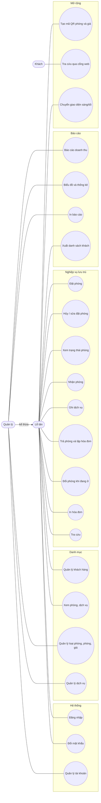

# 1.4 – Use Case cho 2 vai trò

Tác nhân: **Lễ tân** (LT) và **Quản lý** (QL). Quản lý **kế thừa** toàn bộ quyền của Lễ tân.

## 1. Sơ đồ Use Case

Quan hệ giữa các use case (mô hình mục tiêu):
- **Đặt phòng** ⟶ «include» Kiểm tra trùng khoảng ngày
- **Nhận phòng** ⟶ «include» Chọn/tạo khách
- **Trả phòng** ⟶ «include» Tính tiền, «include» Lập hóa đơn, «extend» In hóa đơn
- Mọi use case (trừ Đăng nhập) ⟶ «include» Kiểm tra phân quyền

## 2. Bảng use case

| Mã | Use case | Tác nhân | Mã chức năng (1.1) | Loại |
|---|---|---|---|---|
| UC01 | Đăng nhập | LT, QL | HT01 | BB |
| UC02 | Đổi mật khẩu | LT, QL | HT02 | BB |
| UC03 | Quản lý tài khoản | QL | HT04 | BB |
| UC04 | Quản lý khách hàng | LT, QL | DM04 | BB |
| UC05 | Xem danh mục phòng, dịch vụ | LT, QL | DM02, DM05 | BB |
| UC06 | Quản lý loại phòng, phòng, giá | QL | DM01–DM03 | BB |
| UC07 | Quản lý dịch vụ | QL | DM05 | BB |
| UC08 | Đặt phòng | LT, QL | NV01 | BB |
| UC09 | Hủy / sửa đặt phòng | LT, QL | NV02 | BB |
| UC10 | Xem trạng thái phòng | LT, QL | NV03 | BB |
| UC11 | Nhận phòng | LT, QL | NV04 | BB |
| UC12 | Ghi dịch vụ phát sinh | LT, QL | NV05 | BB |
| UC13 | Trả phòng và lập hóa đơn | LT, QL | NV06 | BB |
| UC14 | In hóa đơn | LT, QL | NV07 | BB |
| UC15 | Tra cứu | LT, QL | TC01 | BB |
| UC16 | Báo cáo doanh thu | QL | BC01 | BB |
| UC17 | Biểu đồ doanh thu và thống kê công suất | QL | BC02, BC04 | BB, NC |
| UC18 | Xem trước và in báo cáo | QL | BC03 | BB |
| UC19 | Xuất danh sách khách đang lưu trú | LT, QL | BC06 | NC |
| UC20 | Tạo mã QR phòng và giá | LT, QL | MR02 | MR |
| UC21 | Tra cứu giá và phòng trống qua cổng web (quét QR) | Khách | MR03 | MR |
| UC22 | Chuyển giao diện sáng/tối | LT, QL | MR01 | MR |
| UC23 | Đổi phòng khi đang lưu trú | LT, QL | NV08 | NC |

**Tình trạng theo source:** UC20–UC22 (mở rộng) có luồng chính trong source. UC23 (đổi phòng) có luồng chính trong source. UC01–UC08 và UC10–UC19 có luồng chính tương ứng ở mức ứng dụng (UC17 doanh thu và công suất, UC18 xem trước/in báo cáo, UC19 xuất CSV danh sách khách đang ở và các báo cáo); UC09 hiện hỗ trợ hủy và đánh dấu không đến, chưa hỗ trợ sửa. Các luồng ngoại lệ và quyền cần được xác nhận bằng kiểm thử giao diện trên máy có SQL Server.

## 3. Đặc tả các use case chính

### UC01 – Đăng nhập
- **Tiền điều kiện:** Ứng dụng đã mở, chưa đăng nhập.
- **Luồng chính:** (1) Nhập tên đăng nhập, mật khẩu. (2) Hệ thống băm mật khẩu và so khớp. (3) Thành công → mở FrmMain, menu hiển thị theo vai trò.
- **Luồng ngoại lệ:** Sai thông tin → báo lỗi, giữ lại form. Tài khoản bị khóa → báo "tài khoản bị khóa". Bỏ trống → báo thiếu dữ liệu.
- **Hậu điều kiện:** Lưu thông tin người dùng hiện tại cho cả phiên.

### UC08 – Đặt phòng
- **Tiền điều kiện:** Đã đăng nhập.
- **Luồng chính:** (1) Chọn ngày đến, ngày đi, loại phòng. (2) Hệ thống liệt kê phòng trống. (3) Chọn phòng. (4) Chọn khách có sẵn hoặc thêm mới. (5) Nhập tiền cọc (nếu có). (6) Lưu.
- **Luồng ngoại lệ:** Ngày đến trong quá khứ hoặc ngày đến ≥ ngày đi → báo lỗi (QT10). Khoảng ngày giao với đặt phòng/phiếu thuê khác → từ chối lưu (QT12). Phòng Bảo trì/Dọn dẹp hoặc ngừng hoạt động không xuất hiện trong danh sách phù hợp (QT05).
- **Hậu điều kiện:** Có bản ghi DatPhong trạng thái Đã đặt.

### UC11 – Nhận phòng
- **Tiền điều kiện:** Phòng Trống hoặc Đã đặt đúng khách.
- **Luồng chính:** (1) Chọn khách đã có trong danh mục. (2) Chọn phòng, ngày đi dự kiến và nhập mã đặt phòng nếu có. (3) Xác nhận nhận phòng. (4) Hệ thống tạo PhieuThue, chụp giá phòng tại thời điểm nhận, chuyển phòng sang Đang ở và cập nhật đặt phòng sang Đã nhận.
- **Luồng ngoại lệ:** Thiếu giấy tờ → không cho nhận (QT22). Phòng đang có người ở → từ chối.
- **Hậu điều kiện:** PhieuThue Đang ở; DatPhong (nếu có) → Đã nhận.

### UC12 – Ghi dịch vụ phát sinh
- **Tiền điều kiện:** Có phiếu thuê Đang ở.
- **Luồng chính:** (1) Chọn phòng/phiếu thuê. (2) Chọn dịch vụ và số lượng. (3) Thêm vào danh sách chi tiết. (4) Lưu.
- **Luồng ngoại lệ:** Số lượng ≤ 0 → báo lỗi. Phiếu thuê đã trả → không cho thêm.
- **Hậu điều kiện:** Có dòng ChiTietDichVu với đơn giá tại thời điểm ghi.

### UC13 – Trả phòng và lập hóa đơn
- **Tiền điều kiện:** Có phiếu thuê Đang ở.
- **Luồng chính:** (1) Chọn phòng cần trả. (2) Hệ thống hiển thị tiền phòng, dịch vụ, phụ thu, cọc. (3) Nhập giảm giá (nếu có), chọn hình thức thanh toán. (4) Xác nhận. (5) Hệ thống chạy **Transaction** (QT50). (6) Hỏi in hóa đơn.
- **Luồng ngoại lệ:** Lỗi bất kỳ bước nào → rollback, thông báo, dữ liệu như cũ. Giảm giá > 10% với Lễ tân → hiện hộp thoại để Quản lý nhập tài khoản duyệt; sai tài khoản hoặc không phải Quản lý → không trả phòng; hóa đơn ghi người duyệt.
- **Hậu điều kiện:** Có HoaDon; PhieuThue Đã trả; phòng Dọn dẹp.

### UC23 – Đổi phòng khi đang lưu trú
- **Tiền điều kiện:** Có phiếu thuê Đang ở; có phòng khác trống trọn thời gian còn lại của kỳ lưu trú.
- **Luồng chính:** (1) Mở Nghiệp vụ → Đổi phòng (F8). (2) Chọn phòng đang ở. (3) Chọn phòng mới trong danh sách phòng trống (kèm tầng, loại, giá); hệ thống nhắc nếu giá khác. (4) Nhập lý do (tùy chọn) và xác nhận. (5) Hệ thống đổi phòng, ghi lịch sử.
- **Luồng ngoại lệ:** Phòng mới vừa bị đặt hoặc có khách → từ chối (QT47), danh sách tải lại. Lý do quá 200 ký tự → báo lỗi. Lỗi bất kỳ bước nào → rollback, dữ liệu như cũ (QT48).
- **Hậu điều kiện:** Phiếu thuê gắn phòng mới; phòng cũ Dọn dẹp; phòng mới Đang ở; có dòng LichSuDoiPhong; đơn giá phiếu thuê không đổi (QT49).

### UC16 – Báo cáo doanh thu
- **Tiền điều kiện:** Đăng nhập với vai trò Quản lý.
- **Luồng chính:** (1) Chọn khoảng thời gian, kiểu nhóm (ngày/tháng/loại phòng). (2) Hệ thống tổng hợp từ HoaDon. (3) Hiển thị bảng và biểu đồ GDI+. (4) Xem trước và in.
- **Luồng ngoại lệ:** Không có dữ liệu → hiển thị thông báo, không vẽ biểu đồ rỗng. Từ ngày > đến ngày → báo lỗi.

**Hiện trạng:** Có bảng, biểu đồ doanh thu theo ngày/tháng/loại phòng, thống kê công suất phòng theo ngày, xem trước/in và xuất CSV.

### UC20 – Tạo mã QR phòng và giá
- **Tiền điều kiện:** Đã đăng nhập; `Web:BaseUrl` đã cấu hình.
- **Luồng chính:** (1) Mở Tra cứu → Mã QR phòng và giá. (2) Chọn một phòng đang hoạt động hoặc Bảng giá toàn khách sạn. (3) Hệ thống sinh QR chứa đường dẫn tương ứng và hiển thị thẻ (tiêu đề, QR, mô tả, đường dẫn). (4) Lưu PNG, in, xuất tất cả hoặc sao chép liên kết.
- **Luồng ngoại lệ:** Nội dung rỗng hoặc quá 213 byte → từ chối (QT67). Không tải được danh sách phòng/giá → báo lỗi tại chỗ, không làm sập màn hình.
- **Hậu điều kiện:** QR chỉ chứa đường dẫn công khai (QT65).

### UC21 – Tra cứu giá và phòng trống qua cổng web
- **Tiền điều kiện:** Cổng web đang chạy và truy cập được từ thiết bị của khách.
- **Luồng chính:** (1) Khách quét QR, mở `/phong/{số phòng}`. (2) Xem loại phòng, giá/đêm, tầng, sức chứa, tình trạng hiện tại. (3) Chọn ngày đến/đi để kiểm tra còn trống và tổng tiền. Hoặc mở `/` (phòng trống) và `/gia` (bảng giá).
- **Luồng ngoại lệ:** Phòng không tồn tại/ngừng hoạt động → trang 404. Ngày sai định dạng, ngày đến trước hôm nay, ngày đến ≥ ngày đi hoặc quá 60 đêm → thông báo lỗi (QT69). CSDL không truy cập được → trang 503 chung, không lộ chuỗi kết nối.
- **Đặc điểm:** Chỉ đọc; không đăng nhập; không hiển thị tên khách.

## 4. Ma trận chức năng – vai trò (dùng để dựng menu ở 5.2)

| Menu | Lễ tân | Quản lý |
|---|---|---|
| Hệ thống → Đăng xuất, Đổi mật khẩu | ✔ | ✔ |
| Hệ thống → Quản lý tài khoản | ✘ | ✔ |
| Danh mục → Khách hàng | ✔ | ✔ |
| Danh mục → Loại phòng, Phòng, Giá | xem | ✔ |
| Danh mục → Dịch vụ | xem | ✔ |
| Nghiệp vụ → Đặt phòng, Nhận phòng, Dịch vụ, Trả phòng | ✔ | ✔ |
| Tra cứu | ✔ | ✔ |
| Báo cáo | ✘ | ✔ |
| Tra cứu → Mã QR phòng và giá | ✔ | ✔ |
| Hệ thống → Giao diện tối (Ctrl+D) | ✔ | ✔ |
| Cổng web tra cứu (khách) | công khai, chỉ đọc | công khai, chỉ đọc |
